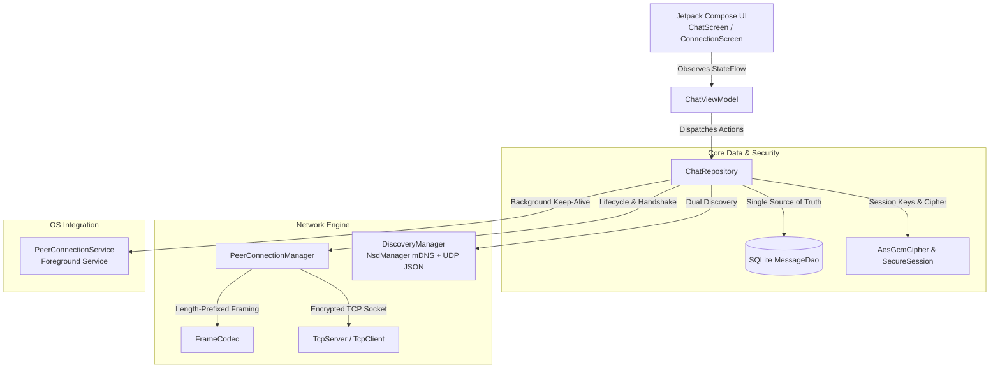

# WhatsOff 📡🔒

> **Zero-Cloud, Peer-to-Peer, End-to-End Encrypted Offline Local Chat for Android.**

WhatsOff allows two Android devices on the same Wi-Fi network, local LAN, or mobile Wi-Fi hotspot to securely discover each other and communicate in real time without cellular data, internet access, or intermediary servers.

---

## 🌟 Key Features

* **🛡️ True End-to-End Encryption (E2E)**:
  * Ephemeral **ECDH (Elliptic-Curve Diffie-Hellman over NIST P-256 / secp256r1)** key exchange on connection handshake.
  * SHA-256 Key Derivation Function (KDF).
  * **AES-256-GCM** authenticated symmetric encryption with 12-byte random IVs and 128-bit authentication tags.
  * Cryptographic **Session Safety Fingerprint** displayed in UI for peer identity verification.
* **📦 Length-Prefixed Binary Framing**:
  * 4-byte Big-Endian length headers protect multi-line messages, newlines, binary emojis, and long payloads against stream fragmentation.
* **🔍 Dual-Engine Discovery**:
  * **Primary**: Android `NsdManager` (DNS-SD / mDNS / Bonjour) on service type `_whatsoff._tcp.` (bypasses router broadcast blocks and AP client isolation).
  * **Fallback**: Structured UDP JSON beacons on port `8888`.
* **💾 Offline-First SQLite Persistence**:
  * Persistent local message history indexed by peer address and timestamp.
  * WhatsApp-style delivery lifecycle: `PENDING` ➔ `SENT` ➔ `DELIVERED` with double checkmark tick indicators.
* **⚡ Android 14+ Foreground Service**:
  * `PeerConnectionService` (`connectedDevice` type) ensures TCP sockets and encryption sessions stay alive when the app is minimized or the screen locks.
* **🎨 Modern Jetpack Compose & Material 3 UI**:
  * WhatsApp-inspired dark/light theme, real-time typing indicators, radar scanning animations, and manual IP fallback.

---

## 🏛️ System Architecture



---

## 🔐 Cryptographic Security Model

WhatsOff implements authenticated end-to-end encryption with Perfect Forward Secrecy (PFS):

```
Device A (Alice)                                    Device B (Bob)
   |                                                    |
   |--- [Frame 1: Handshake (Alice Public Key)] ------->|
   |<-- [Frame 2: Handshake (Bob Public Key)] ----------|
   |                                                    |
   |  Alice computes:                                   |  Bob computes:
   |  K = ECDH(Alice_Priv, Bob_Pub)                     |  K = ECDH(Bob_Priv, Alice_Pub)
   |  AES_Key = SHA-256(K)                              |  AES_Key = SHA-256(K)
   |  Fingerprint = SHA-256(Sort(PubA, PubB))[0..8]     |  Fingerprint = SHA-256(Sort(PubA, PubB))[0..8]
   |                                                    |
   |=== [Encrypted Frame: AES-256-GCM(Message)] =======>|
   |<== [Encrypted Frame: AES-256-GCM(Ack)] ============|
```

1. **Ephemerality**: Key pairs are generated in-memory upon connection initiation and discarded upon disconnect.
2. **Authenticity**: Every frame includes an AES-GCM 128-bit authentication tag. Any payload tampering in transit triggers `AEADBadTagException` and closes the socket.
3. **Verification**: Users can tap the **🔒 E2E Encrypted** badge in the TopAppBar to compare their **Session Safety Number** (e.g., `4C92 · A17E · 8B33 · F019`).

---

## 📡 Wire Protocol Specification

Every packet over TCP port `5000` is encoded using binary length-prefixed frames:

```
+------------------------------------+------------------------------------------+
|  Payload Length (4 Bytes, Big-End) |  AES-256-GCM Encrypted JSON Payload      |
+------------------------------------+------------------------------------------+
```

### Packet Types

| Type | Payload Schema | Description |
| :--- | :--- | :--- |
| `HANDSHAKE` | `{"type":"HANDSHAKE","publicKey":"...","deviceName":"..."}` | Sent once upon TCP accept/connect |
| `MESSAGE` | `{"type":"MESSAGE","id":"...","text":"...","timestamp":...}` | Chat message payload |
| `ACK` | `{"type":"ACK","messageId":"...","status":"DELIVERED"}` | Message delivery confirmation |
| `TYPING` | `{"type":"TYPING","isTyping":true}` | Real-time typing status |
| `PING` / `PONG` | `{"type":"PING","timestamp":...}` | Heartbeat liveness probe |
| `DISCONNECT` | `{"type":"DISCONNECT","reason":"..."}` | Graceful teardown notice |

---

## 🛠️ Tech Stack & Modularity

* **Languages**: 100% Kotlin
* **UI**: Jetpack Compose, Material 3, Compose Navigation
* **Architecture**: MVVM + Repository Pattern + Clean Service Container (DI)
* **Concurrency**: Kotlin Coroutines (`Dispatchers.IO`, `SupervisorJob`), `StateFlow`
* **Local Storage**: Thread-safe SQLite OpenHelper with indexed queries and reactive Flows
* **Target SDK**: Android 16 (API 36), Min SDK: Android 7.0 (API 24)

---

## 🧪 Testing & Verification

Run the full local unit test suite:

```bash
./gradlew testDebugUnitTest
```

### Test Coverage Highlights
* [`AesGcmCipherTest`](file:///Users/namankumar/AndroidStudioProjects/WhatsOff/app/src/test/java/com/example/whatsoff/security/AesGcmCipherTest.kt): ECDH key derivation symmetry, AES-GCM encrypt/decrypt, tampering detection, and fingerprint stability.
* [`FrameCodecTest`](file:///Users/namankumar/AndroidStudioProjects/WhatsOff/app/src/test/java/com/example/whatsoff/protocol/FrameCodecTest.kt): Length-prefixed framing roundtrip, multiline boundary handling, buffer size limits, and packet JSON serialization.
* [`DiscoveryPayloadTest`](file:///Users/namankumar/AndroidStudioProjects/WhatsOff/app/src/test/java/com/example/whatsoff/discovery/DiscoveryPayloadTest.kt): JSON beacon parsing resilience with colons, special characters, and Unicode device names.
* [`ChatViewModelTest`](file:///Users/namankumar/AndroidStudioProjects/WhatsOff/app/src/test/java/com/example/whatsoff/viewmodel/ChatViewModelTest.kt): MessageDao status updates (`SENT` ➔ `DELIVERED`), device sorting, and reactive flows.

---

## 🚀 Running & Testing on Dual Devices

1. Connect both Android devices (or emulators) to the same Wi-Fi router, or enable **Mobile Hotspot** on Device A and connect Device B to it.
2. Build and install:
   ```bash
   ./gradlew installDebug
   ```
3. Open **WhatsOff** on both devices.
4. On Device A, tap **Host a Chat (Listen for Peers)**.
5. On Device B, Device A will appear under **Available Nearby Devices**. Tap **Chat**.
6. Enjoy encrypted, offline peer-to-peer communication!
